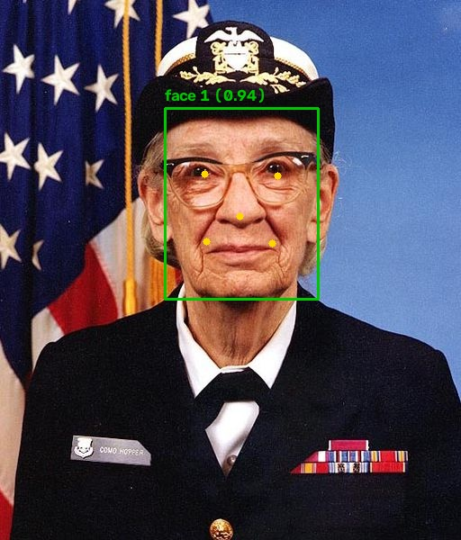

# 🧑‍💻 Facial Verification Pipeline


A real-time computer vision pipeline in Python that finds a face in a video feed, extracts its landmarks, cleans up poor-quality frames, and checks whether the face belongs to an enrolled person. It is built with privacy first: no photo and no raw face embedding is ever saved, only a keyed hash.



## ✨ What it does

1. **Reads a video feed** — a webcam, a video file, a folder of frames or a single image.
2. **Cleans each frame** — measures grain and brightness, then denoises or brightens the frames that need it.
3. **Finds the face and its landmarks** — both eyes, the nose tip and both mouth corners, using the YuNet detector.
4. **Rejects blurred faces** — blur cannot be repaired, so those frames are skipped.
5. **Builds an embedding** — the face is aligned using its landmarks and turned into 128 numbers by the SFace network.
6. **Protects the biometric data** — the embedding is converted into a 2048-bit keyed hash. Only the hash is stored.
7. **Verifies** — a new face is hashed the same way and the differing bits are counted.

```
frame → clean up → detect face + landmarks → align → sharp enough? → embedding → keyed hash → compare
```

## 🔐 How the biometric data is protected

A face embedding is biometric data. If a file of raw embeddings leaked, those faces could be matched against other systems, and a face cannot be changed like a password.

An ordinary hash such as SHA-256 does not work here. Two photos of the same face never give exactly the same embedding, and the smallest change in the input changes a SHA-256 hash completely, so nothing would ever match. This project uses a **BioHash**, a keyed locality-sensitive hash:

1. A secret key and a random per-person salt are stretched with SHAKE-256 into a table of +1 and −1 values.
2. The embedding is projected through that table, and only the **sign** of each result is kept, giving 2048 bits.
3. Two hashes of the same face differ in few bits. Hashes of different faces differ in about half.

| Property | How it is achieved |
|---|---|
| No images or embeddings at rest | Only the hash, salt and an integrity tag are written to disk |
| Useless without the key | The projection table cannot be rebuilt without the secret key |
| Cancellable | Enrolling again uses a fresh salt, and the old hash no longer matches anything |
| Not linkable across systems | A different key gives an unrelated hash for the same face |
| Tamper-evident | Each template carries an HMAC-SHA256 tag bound to the person's name. An edited or renamed file is rejected. |
| Private files | Templates and the key are created with owner-only permissions (`0600`) |
| Safe model files | Each downloaded model is checked against a pinned SHA-256 hash before it is loaded |

The decision threshold comes from SFace's published cosine threshold of 0.363. A sign projection turns an angle into a fraction of differing bits (angle ÷ π), so the same threshold in hash form is acos(0.363) ÷ π = **0.382**.

## 🧹 What the frame clean-up is worth

`scripts/evaluate_quality.py` enrols a clean copy of each sample photo, then compares damaged copies with it, once raw and once after clean-up. The number is the hash distance: lower is better, and above 0.382 the verification would fail.

| Photo | Damage | Raw frame | After clean-up | Fix applied |
|---|---|---|---|---|
| person_a | grain, sigma 20 | 0.112 | 0.083 | median filter |
| person_a | grain, sigma 45 | 0.270 | 0.120 | Gaussian filter |
| person_a | dark, 10% light | 0.150 | 0.130 | contrast boost |
| person_b | grain, sigma 20 | 0.218 | 0.153 | median filter |
| person_b | grain, sigma 45 | no face found | 0.242 | Gaussian filter |
| person_b | grain, sigma 60 | no face found | 0.347 | Gaussian filter |
| person_b | dark, 25% light | 0.135 | 0.085 | contrast boost |

With heavy grain the detector could not find the smaller face at all until the frame was cleaned. Light grain (sigma 10) is left alone, because filtering it did not help.

These figures come from two photographs with synthetic damage. They show that the clean-up works as intended; they are not an accuracy benchmark.

## 🛠️ Tech stack

- **Language:** Python 3
- **Computer vision:** OpenCV (YuNet face detector and SFace recogniser, run through OpenCV's DNN module)
- **Numerics:** NumPy
- **Cryptography:** `hashlib` (SHAKE-256, SHA-256), `hmac`, `secrets` from the standard library
- **Testing:** unittest, run by GitHub Actions on every push

## 📁 Project structure

```
face-verification-pipeline/
├── verify.py                    command-line entry point
├── facepipe/
│   ├── models.py                downloads the model files and verifies their checksums
│   ├── quality.py               noise, brightness and blur measures, and the clean-up
│   ├── detector.py              face detection, landmarks, alignment and embedding
│   ├── template.py              BioHash, template storage, integrity checks
│   └── pipeline.py              the frame-by-frame loop
├── scripts/
│   └── evaluate_quality.py      measures the effect of the clean-up
├── samples/                     two public-domain test photographs
├── tests/                       53 unit and end-to-end tests
└── docs/landmarks.jpg           example output
```

## 🚀 How to run

You need Python 3.9 or newer.

```bash
git clone https://github.com/VijayalaxmiKummari/face-verification-pipeline.git
cd face-verification-pipeline
python3 -m venv .venv && source .venv/bin/activate
pip install -r requirements.txt
python3 verify.py download-models
```

### Try it on the sample photos

```bash
python3 verify.py landmarks --source samples/person_a.jpg --output landmarks.jpg
python3 verify.py enrol grace --source samples/person_a.jpg
python3 verify.py verify grace --source samples/person_a.jpg     # MATCH
python3 verify.py verify grace --source samples/person_b.jpg     # NO MATCH
```

```
[*] 1 frame(s) read: 1 used, 0 without a face, 0 too blurry; 0 denoised, 0 brightened
[*] Hash distance 0.440 (threshold 0.382; same face is near 0.2, a stranger near 0.5)
[✗] NO MATCH: this is not 'grace'.
```

### Use your webcam

```bash
python3 verify.py enrol myname --source 0 --show
python3 verify.py verify myname --source 0 --show
```

`--show` opens a window with the live feed, the face box and the landmarks. Press `q` to stop. On macOS, allow Terminal to use the camera the first time, then run the command again.

Other commands: `python3 verify.py list` and `python3 verify.py delete myname`.

The `templates/` folder and `facepipe.key` are in `.gitignore`, so your own biometric hash and key are never pushed to GitHub.

## ✅ Running the tests

```bash
python3 -m unittest discover tests -v
```

There are 53 tests:

- **Templates (22):** the hash is repeatable, the bit distance follows the angle between embeddings, a wrong key or salt gives an unrelated hash, edited or renamed files are rejected, names cannot escape the storage folder, and files are private.
- **Frame quality (11):** the noise estimate rises with noise, the right filter is chosen, dark frames are brightened, and a clean frame is left untouched.
- **End to end (20):** real detection and landmarks on the sample photos, the same person still matching through grain, darkness, mirroring and resizing, a different person not matching, a video file as input, and the command-line tool.

The end-to-end tests need the model files and are skipped until `download-models` has been run.

## ⚠️ Limitations

- **No liveness detection.** A printed photo or a phone screen held up to the camera would be accepted. A real system needs anti-spoofing.
- **The key sits next to the data.** `facepipe.key` is stored on the same disk as the templates. Anyone who steals both can test guesses against the hashes. In production the key would live in a hardware security module or a secrets manager.
- **Tested on two identities.** The threshold is taken from the SFace paper's figure, not tuned on a large dataset, and I have not measured false accept or false reject rates.
- **Face recognition models are less accurate for some groups of people** than others. This project uses a pre-trained model and inherits its biases.
- **One face at a time.** The largest face in the frame is used.

## 📸 Sample photographs

- `samples/person_a.jpg`: Rear Admiral Grace Hopper, official U.S. Navy portrait (public domain), as distributed with Matplotlib.
- `samples/person_b.jpg`: astronaut Eileen Collins, NASA (public domain), as distributed with scikit-image.

## 📄 Licence

MIT for the code. See [LICENSE](LICENSE). The model files are downloaded from the [OpenCV Model Zoo](https://github.com/opencv/opencv_zoo) under their own licences.
